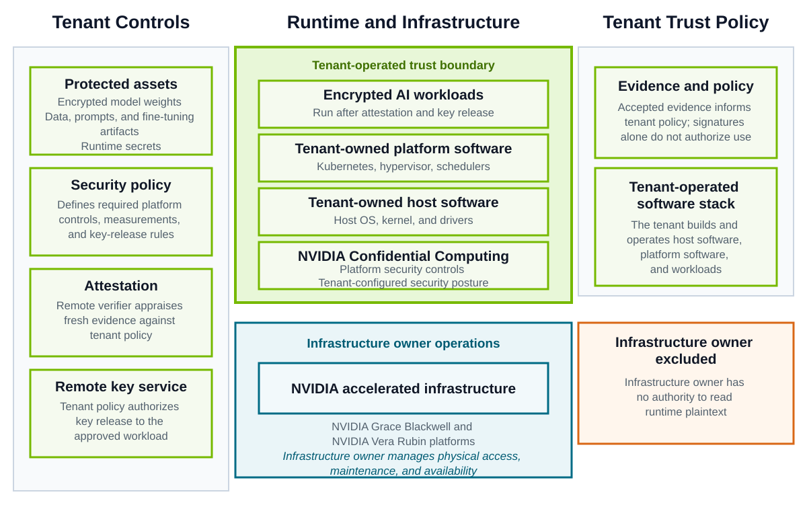
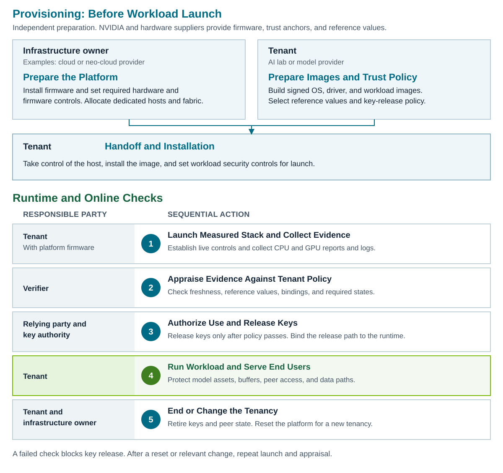

NVIDIA Confidential Bare Metal (CBM) extends NVIDIA Confidential Computing to dedicated bare-metal infrastructure.
It combines measured launch, platform attestation, and platform security controls so a tenant can appraise its environment against policy before releasing model weights, data, and runtime secrets.

CBM is designed for AI labs and model providers that want to own and operate the entire software stack.
The tenant controls the host OS, kernel, drivers, any hypervisor or Kubernetes platform, and the AI workload.
The infrastructure owner, such as a cloud or neo-cloud provider, supplies dedicated infrastructure and performs data center operations.
After handoff and attestation appraisal, the infrastructure owner remains outside the tenant's runtime trust boundary.

The tenant's own privileged administrators and software remain trusted.
CBM does not isolate the workload or protect end-user data from those parties.

The tenant controls remote attestation policy and key management.
The verifier and key service remain trusted for evidence appraisal and key-release authorization, even when deployed outside the host.

## CBM Deployment Modality

CBM places a dedicated host under one tenant organization's control.
The infrastructure owner prepares the platform while the tenant prepares its software images and trust policy.
CBM does not require a confidential virtual machine (CVM).

- **Handoff:** Measured launch and attestation provide evidence for the tenant's appraisal. Key release is gated by tenant policy, including workload requirements beyond the hardware evidence.
- **Tenant operation:** The tenant builds and hardens the host OS, kernel, and drivers, deploys required platform software, and operates the AI workload.
- **Lifecycle:** The tenant manages updates, monitoring, storage and network protection, and remote keys. The tenant re-attests after resets and relevant changes before authorizing secret release.

## Personas

The tenant is the AI lab or model-provider organization that is accountable for the complete software stack and trust policy.
The platform infrastructure administrator and workload owner are functions within that organization, not independent trust domains.
One organization can fill several roles.

The following table describes the CBM personas and their responsibilities:

| Persona | Organization or Scope | Responsibility and Trust Limit |
| --- | --- | --- |
| Cloud infrastructure administrator | Infrastructure owner | Prepares hardware and firmware. Operates power, cooling, the baseboard management controller (BMC), fabric, and storage infrastructure. Remains responsible for availability and agreed physical safeguards. Does not administer tenant software or have authority to read runtime plaintext. |
| Tenant | AI lab or model provider | Is accountable for software selection, accepted components and reference values, trust policy, remote keys, and lifecycle decisions. Assigns platform and workload functions within its organization. Its privileged access to plaintext is trusted. |
| Platform infrastructure administrator | Function within the tenant | Builds, patches, and hardens the host OS, kernel, and drivers. Operates platform software and device access controls. Integrates attestation and key services under tenant policy. |
| Workload owner | Function within the tenant | Owns model assets, serving or training software, workload configuration, and data-use rules. Defines workload access and model-key policy with the platform team. |

A downstream user of the AI service is distinct from the infrastructure tenant.
CBM does not protect that user's prompts, outputs, or other data from the tenant or its trusted serving software.

## Threat Model

CBM protects model weights, data, and keys on dedicated hosts from infrastructure-owner access to runtime plaintext.
This protection includes management access through the BMC without tenant host OS credentials.
Security claims depend on the deployed hardware, firmware, verified protection settings, and hardened tenant software.

The threat model covers the following areas:

- **Runtime Trust Boundary:** The tenant trusts the approved software, hardware, firmware, verifier, and key service, while the infrastructure owner remains outside the runtime TCB.
- **Measured Launch, Attestation, and Key Release:** DRTM and fresh platform evidence let the tenant verify the launched environment before its policy authorizes secure secret delivery.
- **Protection Scope and Tenant Controls:** Platform protections cover supported memory and communication paths, while the tenant hardens software and protects storage, network, and RDMA data.
- **Limits:** CBM does not protect against trusted tenant software and administrators, all physical or side-channel attacks, or infrastructure-owner denial of service.

For detailed threats, mitigations, assumptions, and exclusions, refer to [Trust and Threat Model](./threat-model.mdx).

## Platform Support and Caveats

This release introduces CBM for NVIDIA Grace Blackwell rack-scale and NVIDIA Vera Rubin platforms.
The ownership and trust model is consistent across both platforms, but hardware protections, attestation evidence, and integration requirements differ.

- Use a qualified hardware, firmware, and device configuration with the required security settings enabled. Protections are specific to the supported data paths.
- Plan for substantial tenant engineering and ongoing ownership of the software stack, workload security, attestation, and remote key management.
