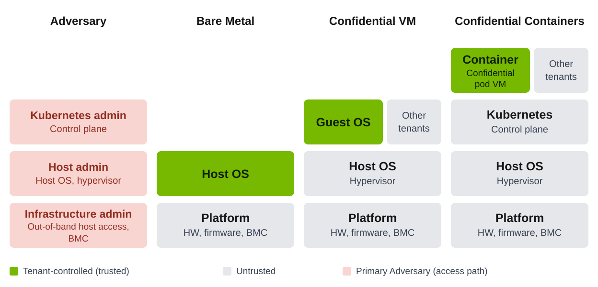
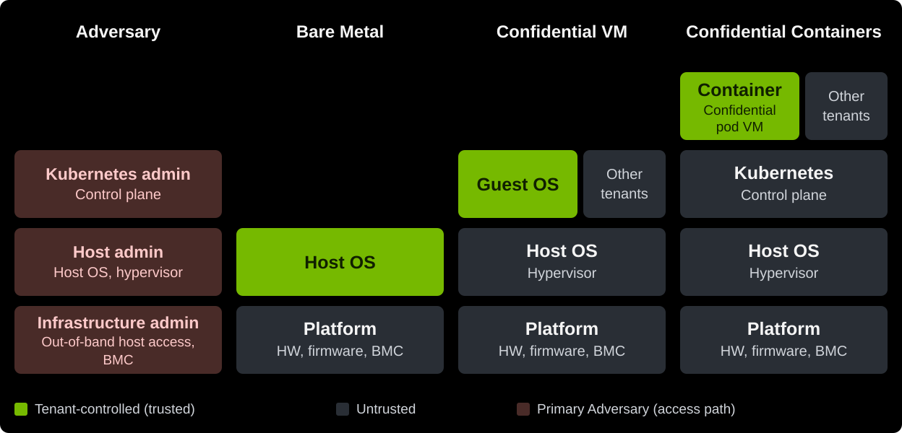
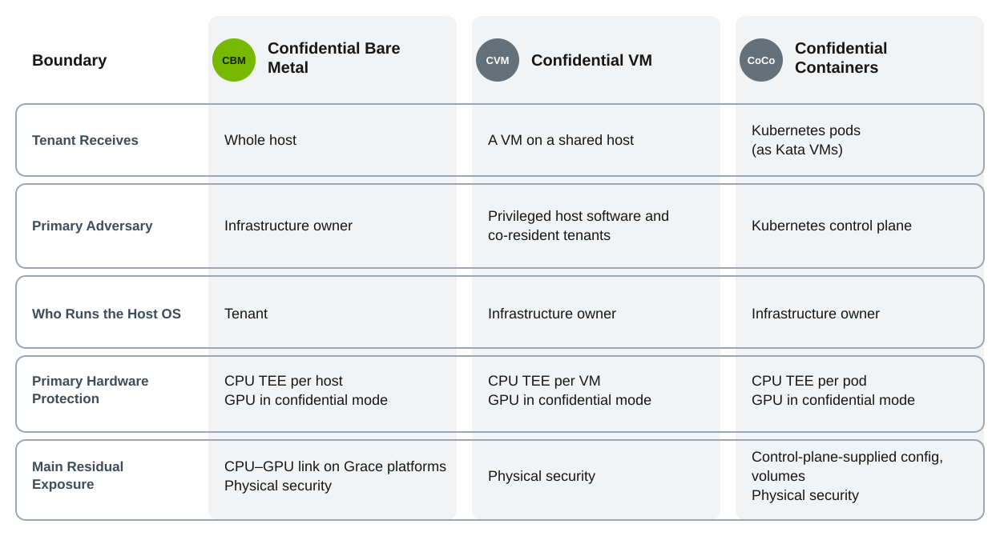
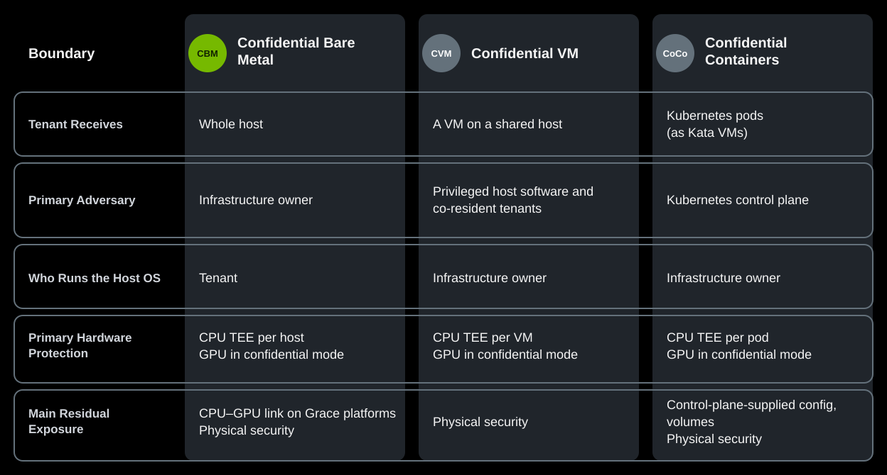

NVIDIA Confidential Computing (CC) extends confidential computing to NVIDIA GPUs.
It combines hardware, software, and services to protect AI workloads, model weights, and sensitive data during processing.
These capabilities form a common foundation for confidential AI.
Attestation is central to this foundation: its evidence supports trust decisions and policy-controlled release of secrets.

Organizations can use this foundation through three deployment modalities: Confidential Bare Metal (CBM), Confidential Virtual Machines (CVMs), and Confidential Containers (CoCo).
Each modality combines NVIDIA CC capabilities with a distinct operating model and trust boundary.
Choose the modality that fits your infrastructure ownership, workload requirements, and security needs.

## Use Cases

NVIDIA Confidential Computing supports the following primary use cases:

- **Protect Model Assets:** Deploy closed-source models or post-trained versions of open source models on enterprise or neo-cloud infrastructure outside the model owner's control. AI labs can release decryption keys only to workloads that satisfy attestation and launch policy, protecting proprietary weights and post-training investments.
- **Protect Sensitive Data During Processing:** Protect sensitive enterprise data, including financial records, healthcare information, and personally identifiable information (PII), while AI workloads process it. The selected deployment model determines which infrastructure administrators are excluded. Protecting data from the model owner requires an additional appropriate boundary.
- **Support Sovereign AI Adoption:** Run AI where data must remain, including approved local or regional infrastructure. Combined with data-residency, access, and governance controls, CC can support sovereignty requirements where moving sensitive data to an external cloud would otherwise be a barrier.

## Deployment Modalities

NVIDIA Confidential Computing defines three standard deployment modalities.
Each modality has a distinct operating model and trust boundary.

<Cards cols={3}>
  <Card
    title="Confidential Bare Metal"
    icon="fa-solid fa-server"
    href="/confidential-computing/bare-metal"
  >
    For AI labs and model providers that receive dedicated hosts and operate the complete software stack. The infrastructure owner remains outside the runtime trust boundary after handoff and successful appraisal.
  </Card>
  <Card
    title="Confidential Virtual Machines"
    icon="fa-solid fa-cube"
    href="/confidential-computing/virtual-machines"
  >
    For VM-based services where the model owner controls guest images and needs a persistent VM lifecycle. A confidential VM boundary isolates the workload from privileged host software.
  </Card>
  <Card
    title="Confidential Containers"
    icon="fa-solid fa-cubes"
    href="/confidential-computing/containers"
  >
    For Kubernetes-native confidential workloads. A Kata microVM and CPU trusted execution environment isolate each confidential pod from the privileged host.
  </Card>
</Cards>

The deployment modalities do not provide interchangeable security guarantees.
Protection depends on the actual topology, trusted software, and enforced policy.
Each modality's documentation defines its supported configurations and availability.

## Trust Boundaries and Threat Model

The following comparison shows the trust boundaries at a glance.
Each deployment modality moves the trust boundary to match who operates the infrastructure.

These boundaries do not automatically protect end-user data from the model owner or eliminate shared-hardware, fabric, physical, or side-channel risks.
Review the model-specific trust and threat documentation before approving a deployment or releasing secrets.

## Shared Security Capabilities and Services

Attestation, launch policy, and secret release connect platform security to workload requirements.
Their integration and ownership depend on the selected deployment modality.

### Attestation and Policy Evaluation

CPU and GPU evidence, reference values, and identity information support appraisal of the environment against workload policy.
Attestation provides evidence for a trust decision; it does not replace the policy that determines whether a workload can receive secrets.

### Key Brokering and Secret Release

A key broker service (KBS) releases secrets according to attestation and launch policy.
The Trustee and KBS architecture connects evidence appraisal and secret retrieval through attesters and launch hooks specific to each deployment modality.

### Launch Policy and Operational Security

Trusted administration and workload-launch paths, hardened infrastructure software, device lifecycle management, networking, and observability support the selected boundary.
Reference architectures and model-specific validation establish the required configuration and isolation checks.

<Cards cols={2}>
  <Card title="Attestation" icon="fa-solid fa-fingerprint" href="https://docs.nvidia.com/attestation/#overview">
    Learn how workloads verify NVIDIA hardware and security configuration before releasing secrets.
  </Card>
  <Card title="Platform Compatibility Matrix" icon="fa-solid fa-table-cells" href="https://www.nvidia.com/en-us/data-center/solutions/confidential-computing/secure-ai-compatibility-matrix/">
    Review supported GPUs, CPUs, drivers, and software versions.
  </Card>
</Cards>
