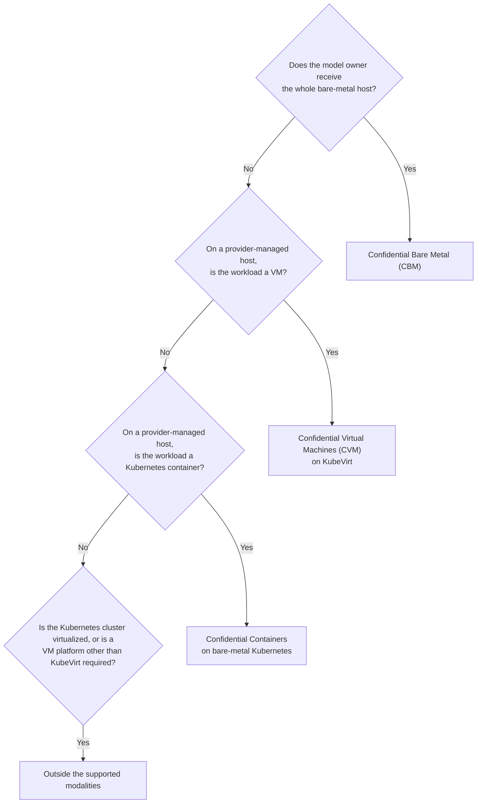
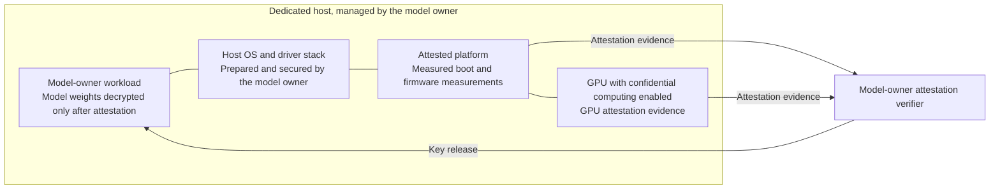
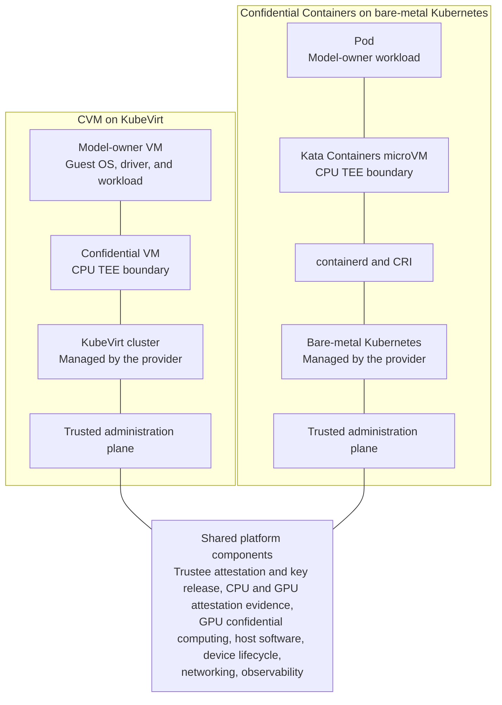

NVIDIA Confidential Computing protects data in use on GPU infrastructure through three deployment modalities: Confidential Bare Metal (CBM), Confidential Virtual Machines (CVM), and Confidential Containers.
Each modality has a different trust boundary, so choose the modality by who manages the host and whom the workload needs protection from.

The three modalities are not ranked against each other.
This page defines the roles that the modalities refer to, explains what each modality protects and does not protect, and helps you select the right modality for your workload.

## Roles

Understanding the deployment modalities requires understanding the following roles.

| Role | Definition |
| --- | --- |
| Infrastructure provider | The organization that owns or operates the host hardware, the platform services, the Kubernetes control plane, or the managed service that runs the workloads. |
| Model owner | The organization, such as an AI lab, that owns the model, the workload, the data, the encryption keys, the attestation policy, and the security requirements. |
| End user | The downstream user, customer, or application whose prompts, embeddings, inference inputs and outputs, or application data must be protected while the model or service runs. |

The roles can overlap depending on who manages the host:

- In a _model-owner-managed_ scenario, the model owner receives the whole host and manages the trust policy inside the model owner's own trust boundary.
  The model owner provides the infrastructure software, including a secure host operating system.
  The model owner also supplies the attestation verification implementation.
  The verification implementation appraises the host operating system measurements and ingests the NVIDIA reference values.
- In a _provider-managed_ scenario, the infrastructure provider manages the host or the control plane. The protection for the model owner and the end user depends on the modality that you choose and the attested trust boundary of that modality.

## Deployment Modalities

NVIDIA Confidential Computing supports the following three modalities:

- [Confidential Bare Metal](/confidential-computing/bare-metal) (CBM) gives the model owner a dedicated bare-metal host with NVIDIA Confidential Computing platform security controls.
- [Confidential Virtual Machines](/confidential-computing/cvm) (CVM) run model-owner VM images with a persistent VM lifecycle on a provider-managed KubeVirt cluster.
- [Confidential Containers](/confidential-computing/containers) run Kubernetes-native confidential workloads on a provider-managed bare-metal Kubernetes cluster.

In all three modalities, the goal is to prevent the infrastructure provider from accessing unencrypted model weights and end-user data. The modalities meet that goal with different trust boundaries:

- **CBM** relies on attestation of the platform and the GPU, plus defense-in-depth platform security controls, instead of a CPU trusted execution environment (TEE). CBM does not need a CPU TEE because no other party shares the host: the model owner administers the host.
- **CBM** minimizes trust in the infrastructure provider by mitigating software attacks and some physical attacks. CBM does not protect end-user data from the model owner. The model owner is responsible for preparing a secure host operating system.
- **CVM** and **Confidential Containers** add a CPU TEE that isolates the workload from privileged host software and actors. These two modalities support provider-managed hosts when the deployment meets the control-plane and tenant-isolation requirements in the [comparison table](#comparison).

## Choosing the Right Modality

Answer the following questions in order. Stop at the first question that you answer with yes.

1. Does the model owner receive the whole host and control of the NVLink fabric? If yes, use **CBM**.
1. On a provider-managed host, is the model owner's workload a VM? If yes, use **CVM**.
1. On a provider-managed host, is the model owner's workload a Kubernetes container workload? If yes, use **Confidential Containers**.
1. Is the Kubernetes cluster itself virtualized, or does your deployment require a VM management platform other than KubeVirt? If yes, the deployment is outside the three supported modalities. Refer to [Deployment Patterns Out of Consideration](#deployment-patterns-out-of-consideration).

The following diagram shows the selection flow:

## Reference Architectures

All three deployment modalities use host infrastructure software, GPU and device lifecycle management, networking, and observability.
CVM and Confidential Containers also share Kubernetes platform services, Trustee-based attestation and key release, and a trusted administration plane.
In CBM, the model owner provides the attestation verification implementation.

### Confidential Bare Metal

In CBM, the model owner, not the infrastructure provider, administers the host.
Trust comes from measured boot and attestation of the platform and the GPU rather than from a CPU TEE.
The model owner verifies the platform before transferring any protected material, such as model weights, to the workload.

The following diagram shows the CBM stack and the attestation flow. The model weights stay encrypted until the model owner's attestation verifier appraises the attestation evidence and the model owner releases the decryption key to the workload.

The model owner's attestation verifier appraises the following items before the model owner releases a key:

- CPU and GPU attestation evidence
- NVIDIA reference values for the CPU firmware, the GPU firmware, and the GPU microcode
- Measurements of the host operating system and the model owner's software stack

### Confidential Virtual Machines and Confidential Containers

CVM and Confidential Containers both run on provider-managed hosts, and both isolate the model owner's workload from the privileged host with a CPU TEE. The two modalities differ in workload type and in who owns the workload lifecycle.

The following diagram shows the CVM and Confidential Containers stacks and the platform components that both stacks share. In both stacks, the CPU TEE boundary separates the model-owner workload from the provider-managed layers below the TEE boundary.

### Attestation and Key Release

CVM and Confidential Containers use an attestation architecture based on the [Trustee](https://github.com/confidential-containers/trustee) project from Confidential Containers.
Trustee includes a Key Broker Service (KBS) that verifies CPU and GPU attestation evidence against reference values and an attestation policy, and then releases keys and other secrets only to workloads that pass verification.
In CBM, the model owner supplies the attestation verification implementation.

## Comparison

The following table compares the three deployment modalities.

| Dimension | CBM | CVM | Confidential Containers |
| --- | --- | --- | --- |
| Best fit | Dedicated bare-metal hosts for a single model owner | VM as a service, model-owner VM images, persistent VM lifecycle | Kubernetes-native confidential workloads |
| Who manages the host | Model owner | Infrastructure provider | Infrastructure provider |
| Isolation boundary | Host | VM, if you isolate the KubeVirt cluster | Pod or workload, if you separate the Kubernetes control plane |
| Isolation from a privileged host | No CPU TEE. Relies on platform attestation, GPU confidential computing, and platform security controls. | Yes. A confidential VM provides a CPU TEE for each VM. | Yes. A Kata Containers microVM provides a CPU TEE for each workload. |
| Control-plane requirement | The model owner receives the host and control of the NVLink fabric. The administration services and the workload launch path stay inside the model owner's trust boundary. | The model owner has no Kubernetes credentials on the KubeVirt cluster, the host has no out-of-band access path into the VM, and you isolate the model owner's network. | A single-tenant Kubernetes control plane, or a separate control plane for each tenant. |
| Operational effort for the model owner | Highest. The model owner manages the whole stack, including a secure host operating system and the attestation verification implementation. | Medium. The model owner owns the VM images and the VM lifecycle. | Lowest. The model owner deploys standard Kubernetes workloads. |
| Protection from the infrastructure provider | CBM minimizes trust in the provider after the model owner receives the dedicated host and verifies the platform and GPU state. CBM mitigates software attacks and some physical attacks. The model owner remains responsible for managing the stack, including a secure host operating system. | The confidential VM protects model-owner data and end-user data from the provider-managed host, if you isolate the KubeVirt cluster, give the model owner no Kubernetes credentials, allow no out-of-band access path from the host into the VM, and isolate the model owner's network. | The CPU TEE and the Kata Containers isolation protect model-owner data and end-user data from the provider-managed host, if you enforce tenant separation, control-plane separation, and the attestation policy. |

<Warning title="Limits of confidential computing">
In all three modalities, confidential computing protects the confidentiality of data in use and the integrity of the workload within a defined trust boundary.
Confidential computing does not automatically remove every risk from shared hardware, shared network fabric, other tenants, or side channels.
Rely on multi-tenant isolation only when your actual deployment topology provides the required isolation.
</Warning>

## Use Cases

The three deployment modalities address the following use cases:

- **Model weight protection.** Store the model weights encrypted, and release the decryption key only to a workload that passes attestation.
- **End-user data protection.** Protect sensitive end-user data, such as prompts, embeddings, inference inputs and outputs, and application data, during processing.
   Release secrets only to verified workloads that run in the intended modality, including on provider-managed hosts.

## Deployment Patterns Out of Consideration

The following deployment patterns are technically valid, and some patterns run in production today.
NVIDIA does not offer these patterns as reference architectures because each pattern multiplies the combinations of CPU vendor, hypervisor, Kubernetes distribution, GPU attestation topology, and GPU passthrough configuration that NVIDIA must test.

| Deployment pattern | Reason the pattern is outside the supported modalities |
| --- | --- |
| Confidential VMs on a conventional provider-managed hypervisor | The infrastructure provider owns the hypervisor and the attestation verifier, so NVIDIA cannot own the chain of trust end to end. |
| Peer pods, or Confidential Containers on virtualized Kubernetes | NVIDIA has not validated the GPU attestation and GPU passthrough path as a reference architecture and does not provide support for this pattern. |
| Nested or partitioned virtualization | The pattern is not yet standardized, and NVIDIA does not validate this pattern. |

For these deployment patterns, NVIDIA does not provide a validation matrix, GPU attestation coverage, or support as a reference architecture. A deployment of one of these patterns can be production-grade for the organization that runs the deployment. If your requirements mandate one of these patterns, NVIDIA handles the deployment as a custom engagement with scoped validation and an explicitly bounded support commitment.

## Related Topics

- [Threat Model Comparison](./threat-model)
- [Hopper and Blackwell CC Capabilities](./gpu-capabilities)
- [NVIDIA Attestation](https://docs.nvidia.com/attestation/#overview)
- [Platform Compatibility Matrix](https://www.nvidia.com/en-us/data-center/solutions/confidential-computing/secure-ai-compatibility-matrix/)
