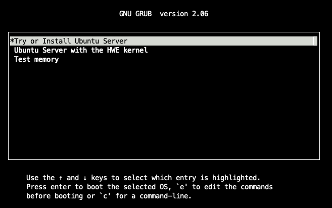
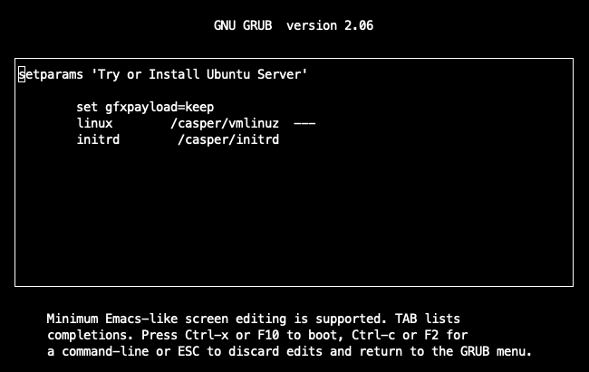
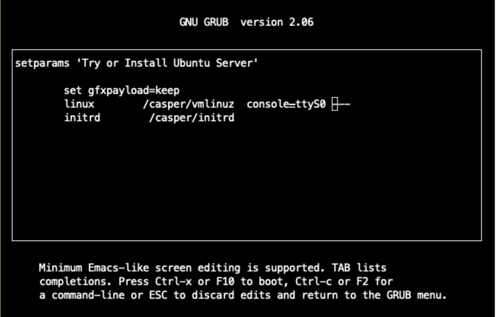

The Host OS Administrator can use KVM and QEMU to create and launch a CVM with GPUs attached.
This page is optional.
If you have existing VMs or an orchestration flow, use your own flow and continue with [Configuring the Guest](./deploy-guest.mdx).

<Note>
Because of CPU Confidential Computing limitations, a reboot command in the CVM terminates the VM.
This behavior is expected for every reboot.
Launch the CVM again after each reboot.
</Note>

## Intel TDX

Intel refers to CVMs as Trust Domains (TDs).
The Canonical TDX scripts that you downloaded in [Configuring the Host](./deploy-host.mdx#configuring-tdx-on-intel-hosts) create and launch the TD.

### Creating the TD

1. Create an Ubuntu 24.04 guest image:

   ```console
   $ cd /shared/tdx/guest-tools/image/
   $ sudo ./create-td-image.sh -v 24.04
   ```

1. Edit `/shared/tdx/guest-tools/run_td` and replace the `add_gpus` function with the following function, which attaches each GPU to its own PCIe root port through `iommufd`:

   ```python
   def add_gpus(cmd, gpus):
       if len(gpus) <= 0:
           return
       cmd.extend(['-object', 'iommufd,id=iommufd0'])
       index = 0
       for gpu in gpus:
           gpu_cmd = ['-device', f'pcie-root-port,id=pci.{index+10},bus=pcie.0,chassis={index+10}',
                      '-device', f'vfio-pci,host={gpu},bus=pci.{index+10},iommufd=iommufd0']
           cmd.extend(gpu_cmd)
           index = index + 1
   ```

### Launching the TD

1. Optional: For maximum performance, if you downloaded the standalone version of pepc to `/shared/pepc`, set the CPU frequency governor and disable C-states:

   ```console
   $ sudo /shared/pepc/pepc.standalone pstates config --governor performance
   $ sudo /shared/pepc/pepc.standalone cstates config --disable C1E,C6
   ```

1. Identify the NVIDIA GPUs.
   The following example shows the GPUs on an NVIDIA DGX B200 system:

   ```console
   $ lspci -d 10de:
   1b:00.0 3D controller: NVIDIA Corporation GB100 [B200] (rev a1)
   43:00.0 3D controller: NVIDIA Corporation GB100 [B200] (rev a1)
   52:00.0 3D controller: NVIDIA Corporation GB100 [B200] (rev a1)
   61:00.0 3D controller: NVIDIA Corporation GB100 [B200] (rev a1)
   9d:00.0 3D controller: NVIDIA Corporation GB100 [B200] (rev a1)
   c3:00.0 3D controller: NVIDIA Corporation GB100 [B200] (rev a1)
   d1:00.0 3D controller: NVIDIA Corporation GB100 [B200] (rev a1)
   df:00.0 3D controller: NVIDIA Corporation GB100 [B200] (rev a1)
   ```

1. Launch the TD with the GPUs attached.
   To attach every NVIDIA GPU, set `GPU_LIST` from the `lspci` output.
   To attach specific GPUs, specify their PCIe addresses, such as `1b:00.0`, in the `--gpus` argument instead of `$GPU_LIST`.

   ```console
   $ GPU_LIST="$(lspci -Dn -d 10de: | awk '{print tolower($1)}' | paste -sd' ' -)"
   $ sudo /shared/tdx/guest-tools/run_td \
       --image=/shared/tdx/guest-tools/image/tdx-guest-ubuntu-24.04-generic.qcow2 \
       --gpus $GPU_LIST
   ```

   Example output:

   ```output
   TD started by QEMU with PID: 13392.
   To log in with the non-root user (default: tdx / password: 123456), as specified in setup-tdx-config, use:
      $ ssh -p 10022 <username>@localhost
   To log in as root (default password: 123456), use:
      $ ssh -p 10022 root@localhost
   ```

   <Warning>
   Change the default guest passwords after the first boot.
   </Warning>

### Validating the TD

1. Log in to the TD by using SSH.
   Replace `root` with the user name that you configured:

   ```console
   $ ssh -p 10022 root@localhost
   ```

1. Confirm that the guest kernel detects TDX:

   ```console
   $ sudo dmesg | grep -i tdx
   [    0.000000] tdx: Guest detected
   [   29.669467] process: using TDX aware idle routine
   [   29.669467] Memory Encryption Features active: Intel TDX
   [   46.864001] systemd[1]: Detected confidential virtualization tdx.
   ```

## AMD SEV-SNP

### Creating the VM

1. Download an ISO image of a supported guest OS.
   The following example uses Ubuntu 24.04:

   ```console
   $ cd /shared
   $ wget https://releases.ubuntu.com/noble/ubuntu-24.04.5-live-server-amd64.iso
   ```

1. Create a virtual disk for the VM.
   Change `500G` to the disk size that you need:

   ```console
   $ qemu-img create -f qcow2 /shared/ubuntu.qcow2 500G
   ```

1. Create the `/shared/launch_vm.sh` script with the following content:

   ```bash
   #!/bin/bash

   CORES=16
   MEM=32G
   VDD_IMAGE=/shared/ubuntu.qcow2
   FWDPORT=9899
   CDROM=/shared/ubuntu-24.04.5-live-server-amd64.iso

   doecho=false
   docc=true
   sev=""

   while getopts "expc:" flag
   do
     case $flag in
       e) doecho=true;;
       x) docc=false;;
       p) FWDPORT=$OPTARG;;
       c) sev=$OPTARG;;
     esac
   done

   NVIDIA_GPU=$(lspci -d 10de: | awk '/NVIDIA/{print $1}')
   NVIDIA_PASSTHROUGH=$(lspci -n -s $NVIDIA_GPU | awk -F: '{print $4}' | awk '{print $1}')

   if [ "$doecho" = true ]; then
     echo 10de $NVIDIA_PASSTHROUGH > /sys/bus/pci/drivers/vfio-pci/new_id
   fi

   get_cbitpos() {
     modprobe cpuid
     EBX=$(dd if=/dev/cpu/0/cpuid ibs=16 count=32 skip=134217728 | tail -c 16 | od -An -t u4 -j 4 -N 4 | sed -re 's|^ *||')
     CBITPOS=$((EBX & 0x3f))
   }

   if [ "$docc" = true ]; then
     if [ -n "$sev" ]; then
       case "$sev" in
         sev|sev-es|sev-snp)
           SEV_MODE="$sev"
           USE_CC=true
           get_cbitpos
           ;;
         *)
           echo "Error: unsupported SEV mode '$sev'."
           echo "Use '-c' with valid options: sev, sev-es, sev-snp."
           echo "Or use '-x' to boot without CC modes"
           exit 1
           ;;
       esac
     fi
   fi

   qemu-system-x86_64 \
     -bios /usr/share/ovmf/OVMF.fd \
     -nographic \
     ${USE_CC:+  -machine confidential-guest-support=sev0,vmport=off} \
     ${USE_CC:+$( [ "$SEV_MODE" = sev ] && \
       echo "  -object sev-guest,id=sev0,cbitpos=$CBITPOS,reduced-phys-bits=1,policy=0x1" )} \
     ${USE_CC:+$( [ "$SEV_MODE" = sev-es ] && \
       echo "  -object sev-guest,id=sev0,cbitpos=$CBITPOS,reduced-phys-bits=1,policy=0x5" )} \
     ${USE_CC:+$( [ "$SEV_MODE" = sev-snp ] && \
       echo "  -object sev-snp-guest,id=sev0,cbitpos=$CBITPOS,reduced-phys-bits=1,policy=0x30000" )} \
     -vga none \
     -enable-kvm -no-reboot \
     -cpu EPYC-v4 \
     -machine q35 -smp $CORES -m $MEM,slots=2,maxmem=512G \
     -drive file=$VDD_IMAGE,if=none,id=disk0,format=qcow2 \
     -device virtio-scsi-pci,id=scsi0,disable-legacy=on,iommu_platform=true,romfile= \
     -device scsi-hd,drive=disk0 \
     -netdev user,id=vmnic,hostfwd=tcp::$FWDPORT-:22 \
     -cdrom $CDROM \
     -device virtio-net-pci,disable-legacy=on,iommu_platform=true,netdev=vmnic,romfile= \
     -object iommufd,id=iommufd0 \
     -device pcie-root-port,id=pci.1,bus=pcie.0 \
     -device vfio-pci,host=$NVIDIA_GPU,bus=pci.1,iommufd=iommufd0,romfile=
   ```

   The script accepts the following options:

   | Option | Description |
   | --- | --- |
   | `-e` | Binds the GPU to the `vfio-pci` driver before launching the VM. |
   | `-x` | Launches the VM without CPU Confidential Computing. |
   | `-c <mode>` | Launches the VM with the `sev`, `sev-es`, or `sev-snp` mode. |
   | `-p <port>` | Forwards the host port to SSH in the guest. The default is `9899`. |

1. Make the script executable:

   ```console
   $ chmod +x /shared/launch_vm.sh
   ```

### Installing the Guest OS

1. Launch the VM with CPU Confidential Computing disabled:

   ```console
   $ sudo /shared/launch_vm.sh -ex
   ```

1. In the GRUB menu, highlight **Try or Install Ubuntu Server**.

   

1. Press <kbd>e</kbd> to edit the boot commands.

   

1. Add `console=ttyS0` to the `linux` line so that the kernel prints to the serial console:

   ```text
   linux        /casper/vmlinuz  console=ttyS0 ---
   ```

   

1. Press <kbd>Ctrl</kbd>+<kbd>X</kbd> to continue booting.

1. Complete the guest OS installation.
   The installation doesn't require specific options.
   When the installation finishes, Ubuntu prompts you to reboot, the VM terminates, and you return to the host.

### Finalizing the Guest OS

1. Edit `/shared/launch_vm.sh` and remove the following line so that the VM boots from the virtual disk:

   ```bash
     -cdrom $CDROM \
   ```

1. Launch the VM with CPU Confidential Computing disabled:

   ```console
   $ sudo /shared/launch_vm.sh -x
   ```

1. Log in to the VM.
   The console shows a welcome message similar to the following example:

   ```output
   Welcome to Ubuntu 24.04.2 LTS (GNU/Linux 6.8.0-57-generic x86_64)
   ...
   user@guest:~$
   ```

### Configuring PCIe BAR Remapping

OVMF can fail to assign ACPI addresses to PCIe devices with large amounts of memory.
To work around this issue, configure the guest kernel to reallocate the PCIe resources.

1. In the guest, edit `/etc/default/grub` and add `pci=realloc,nocrs` to `GRUB_CMDLINE_LINUX_DEFAULT`:

   ```text
   GRUB_CMDLINE_LINUX_DEFAULT="console=ttyS0 pci=realloc,nocrs"
   ```

1. Update GRUB and reboot.
   The reboot terminates the VM:

   ```console
   $ sudo update-grub
   $ sudo reboot
   ```

1. On the host, launch the VM with SEV-SNP enabled:

   ```console
   $ sudo /shared/launch_vm.sh -c sev-snp
   ```

### Validating the VM

In the guest, confirm that SEV-SNP memory encryption is active:

```console
$ sudo dmesg | grep -i sev
[    1.261594] Memory Encryption Features active: AMD SEV SEV-ES SEV-SNP
[    1.376509] SEV: APIC: wakeup_secondary_cpu() replaced with wakeup_cpu_via_vmgexit()
[    1.482689] SEV: Using SNP CPUID table, 28 entries present.
[    1.903332] SEV: SNP guest platform device initialized.
[    6.028948] sev-guest sev-guest: Initialized SEV guest driver (using vmpck_id 0)
```

The CVM now runs with one or more confidential GPUs attached.
Continue with [Configuring the Guest](./deploy-guest.mdx).
