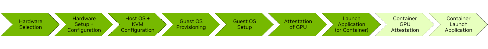
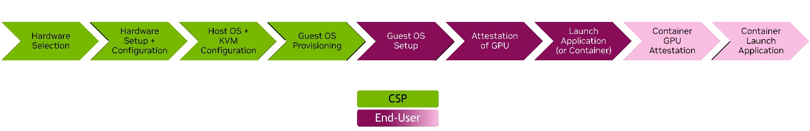

A confidential virtual machine (CVM) runs inside a hardware-enforced trusted execution environment on a host with AMD SEV-SNP or Intel TDX.
NVIDIA Hopper and Blackwell GPUs that you pass through to the CVM extend that protection to GPU memory and to the data that moves between the CPU and the GPU.

The documentation for this product covers the following GPU modes:

- Confidential Computing (CC) mode with one GPU per CVM, on Hopper and Blackwell GPUs.
- CC mode with multiple GPUs per CVM, on Blackwell GPUs.
- Protected PCIe (PPCIe) mode with multiple GPUs per CVM, on Hopper GPUs.

Refer to [Supported Platforms](./supported-platforms.mdx) for the validated combinations of CPUs, GPUs, and operating systems.

## Workflow

The following figure shows the stages of deploying and using a CVM with confidential GPUs.

Different people can complete different stages.
For example, a cloud service provider (CSP) can select and configure the hardware, configure the host, and provision the guest VM.
A tenant of the CSP then sets up the guest OS, attests the GPU, and runs applications.

In this example, the CSP does not decide how often the tenant attests the GPU, and the tenant does not configure the GPU for confidential or non-confidential modes.

## Personas

The [Deployment Guide](./deployment-guide.mdx) is organized by the following personas.
Start with the section that matches your responsibilities, or read every section in order if you deploy the entire system.

| Persona | Responsibilities | Section |
| --- | --- | --- |
| Hardware IT Administrator | Selects CPUs and GPUs that support Confidential Computing and configures the BIOS. Includes system architects and IT administrators. | [Configuring the Hardware](./deploy-hardware.mdx) |
| Host OS Administrator | Installs and configures the host OS and hypervisor, configures the GPU mode, and provisions CVMs. Includes system architects, cloud administrators, and advanced on-premises users. | [Configuring the Host](./deploy-host.mdx), [Configuring the GPUs](./deploy-gpu-mode.mdx), and [Creating a Confidential VM](./deploy-create-vm.mdx) |
| Virtual Machine Administrator | Receives a CVM with GPUs attached by the hypervisor and installs and configures the NVIDIA driver. Most users start here. | [Configuring the Guest](./deploy-guest.mdx) |
| Virtual Machine User | Attests the GPU and runs confidential applications in a configured CVM. | [Attesting the GPU](./deploy-attest.mdx) |

## Getting Help

To provide feedback or ask questions, use the [NVIDIA Developer Forums for Confidential Computing](https://forums.developer.nvidia.com/c/accelerated-computing/confidential-computing/663).
